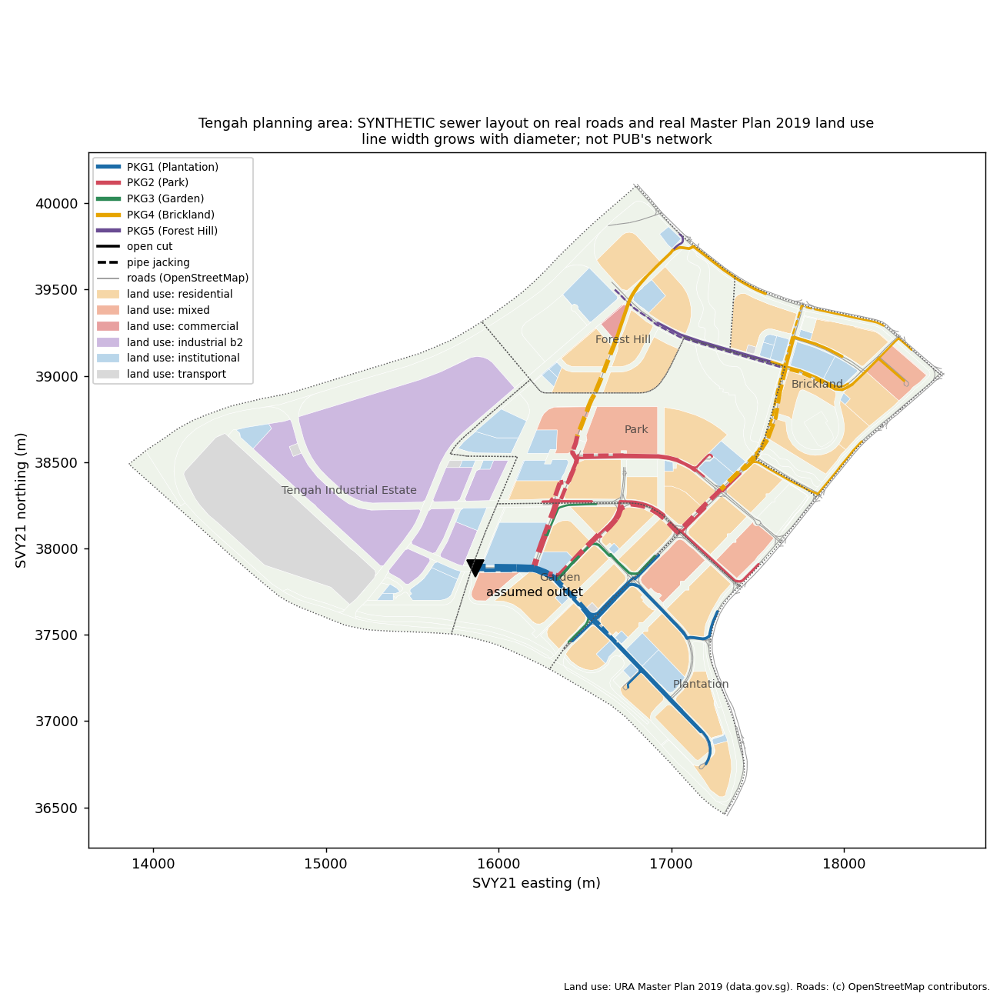
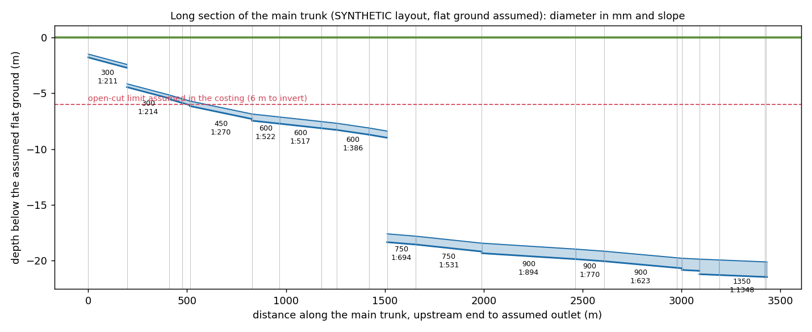
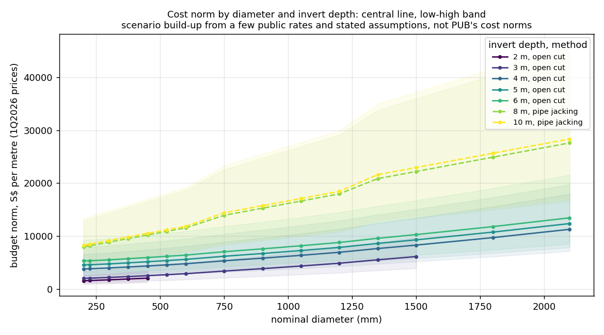
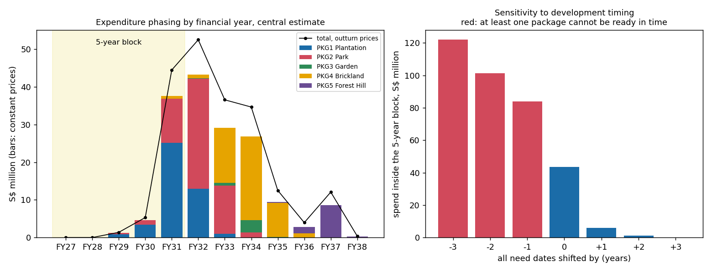

# sg-sewerage-planning

**Screening-level planning study of a used-water (sewerage) network for one Singapore planning area, Tengah: flow projection from Master Plan land use, a gravity sewer network sized to PUB's Code of Practice, a cost-norm table, and a programme rolled into a 5-year block budget.**

> **Read this first.** This is a personal desk study, not a PUB plan. The land use and the roads are real public data. The sewer layout, the outlet, the ground level, most unit rates, every programme duration and every need date are SYNTHETIC or ASSUMED, and are labelled so wherever they appear. Parts of Tengah are already built and sewered; this study ignores the real network (it is not public) and plans the town from a clean sheet to exercise the method. Nothing here is a design, a cost estimate fit for funding, or professional engineering advice. PUB's Code of Practice is referenced, not redistributed ([DATA_SOURCES.md](DATA_SOURCES.md)).

<!-- README.md is generated from docs/README.template.md by scripts/run_all.py. Do not edit README.md by hand. -->

## What it does

1. **Flows by land use.** 105 flow-generating parcels of the URA Master Plan 2019 in the Tengah planning area. Housing uses the per-capita flows, persons per dwelling and peak factor of PUB's Code of Practice on Sewerage and Sanitary Works (COPSSW, 3rd Edition, March 2025); non-residential land uses proxy rates that are labelled as assumptions.
2. **Network sizing.** A SYNTHETIC tree of gravity sewers along real roads (OpenStreetMap) to one assumed outlet: 105 reaches, 21.8 km. Manning's equation for part-full pipes, with the COPSSW depth-of-flow limits, velocity limits, minimum size, minimum depth and manhole spacing.
3. **Cost norms.** A S$ per metre table by diameter and depth with low, central and high values, built up from the few unit rates that are public and from stated assumptions for the rest.
4. **Programme and budget.** Packages, lead times including funding approval, monthly cashflow, financial-year phasing, a 5-year block budget (FY2027 to FY2031), and how the block moves when development comes earlier or later.
5. **Receiving-sewer check.** A what-if table: how large and how empty the existing downstream sewer would have to be for the town not to trigger an expansion.
6. **A two-page funding-paper-style brief:** [docs/funding_brief.md](docs/funding_brief.md) ([PDF](docs/funding_brief.pdf)).

## Headline numbers

All values below are generated from files in [`results/`](results/) by `scripts/run_all.py`. Prices are 1Q2026.

| | | Source file |
|---|---|---|
| Design population and flow | 42,000 homes x 3.5 persons = 147,000 people; average dry-weather flow 39.9 ML/d (13% non-residential); design peak 1,384 L/s | `results/summary.json`, `flows_by_parcel.csv` |
| Network (synthetic) | 21.8 km in 105 reaches, 200 to 1350 mm, 242 manholes; 5.2 km is 600 mm or larger | `results/network_design.csv` |
| COPSSW checks | depth of flow within the limit in every reach: yes. Peak velocity 0.9 to 2.4 m/s met in 105 less 12 reaches; 12 head reaches (3.1 km) carry too little flow to be self-cleansing at 1 in 100 and are flagged | `results/network_design.csv` |
| Depth | mean invert depth 6.5 m, deepest 21.5 m (flat ground assumed); 8.6 km (39% of length) is deeper than 6 m and costed as pipe jacking | `results/summary.json` |
| Programme budget | S$ 163.9 million central, S$ 98.4 to 268.7 million low to high (-40% / +64%); S$ 7,511 per metre on average | `results/packages.csv`, `summary.json` |
| Lead time | 50 months (4.2 years) from programme start to the first usable sewer on the assumed durations | `results/schedule.csv` |
| 5-year block FY2027 to FY2031 | S$ 43.4 million at constant prices (26% of the programme), S$ 51.2 million outturn; peak year FY2032 at S$ 43.3 million | `results/cashflow_fy.csv` |
| Development one year earlier | block rises to S$ 83.9 million and 1 package(s) cannot be ready in time (worst 6 months late) | `results/timing_sensitivity.csv` |
| Development one year later | block falls to S$ 5.8 million | `results/timing_sensitivity.csv` |
| Receiving sewer | an empty 1500 mm sewer is the smallest that takes the ultimate peak; if half its capacity is already used: 2100 mm | `results/capacity_trigger.csv` |

Three things the numbers say:

- **The block budget is driven by timing, not by the estimate.** Moving every need date by one year changes the 5-year block from S$ 43.4 million to S$ 83.9 million or S$ 5.8 million. The whole low-to-high cost range moves it less than that in proportion.
- **Depth, not diameter, is the cost.** On flat ground a gravity network 3.43 km long along its main trunk ends 21.5 m down. Pipe jacking is 39% of the length and 73% of the direct cost.
- **The "approximately 1.5 m/s" of COPSSW clause 3.2.1(e)(i) is out of reach on flat ground.** With no reach steeper than 1 in 100, choosing diameters for up to 1.0, 1.2 or 1.5 m/s moves the budget by only S$ 1.4 million, and even the 1.5 m/s choice averages 1.02 m/s ([trade-off table](#velocity-against-depth)). Depth comes from the length of the layout, not from the velocity target.



## How to run

Python 3.11.

```bash
python -m venv .venv
. .venv/bin/activate            # Windows: .venv\Scripts\activate
pip install -r requirements.txt
python scripts/run_all.py       # flows, network, costs, programme, figures, README, brief
pytest                          # tests (offline)
python mutation/run_mutants.py  # optional: mutation test of the test suite
```

`scripts/run_all.py` rewrites everything under `results/` and regenerates this README and the brief from the templates in `docs/`. The committed inputs in `data/inputs/` were made from the raw public downloads by `scripts/fetch_data.py` and `scripts/prepare_inputs.py` (`pip install -r requirements-tools.txt`); the pipeline and the tests never go online.

## 1. Flows

**Method.** HDB's published figure for the town (42,000 homes) is spread over the Master Plan parcels in proportion to their residential gross floor area (site area x gross plot ratio; 60% of the floor area of "Commercial & Residential" parcels is taken as housing: assumption). The parcels give 522 ha of residential floor area, so the allocation implies 124 m2 of gross floor area per home, which is the plausibility check on combining the two sources.

| Parameter | Value | Basis |
|---|---|---|
| Persons per dwelling | 3.5 | COPSSW cl. 3.2.1(a) |
| Average domestic daily flow | 230 L per capita per day public housing, 250 private | COPSSW cl. 3.2.1(a), Table 4 |
| Housing mix | 30,000 public, 12,000 private, so 235.7 L per capita per day town-wide | press reports of HDB's 2016 announcement (secondary source) |
| Peak factor | 3 | COPSSW Table 4; applied to non-residential flow too (assumption) |
| Non-residential | water-use benchmark x floor area x 0.9 return factor | COPSSW cl. 3.2.1(b) gives no rates: PUB's published retail (1.1 m3/m2/year) and office (1.0 m3/m2/year) medians are used as proxies, and plot ratios are assumed where the Master Plan shows "EVA" or "SDP". All of this is assumption; see `config/study.json` |
| Infiltration | none | not in the COPSSW design basis; a real study would take PUB's view |

| Subzone (URA) | Parcels with flow | Homes allocated | Residential ADWF (m3/d) | Non-residential ADWF (m3/d) | Peak flow (L/s) |
|---|---|---|---|---|---|
| Park | 20 | 11,415 | 9,417 | 1,062 | 364 |
| Plantation | 15 | 9,495 | 7,834 | 361 | 285 |
| Brickland | 22 | 7,263 | 5,992 | 364 | 221 |
| Garden | 14 | 6,981 | 5,759 | 313 | 211 |
| Forest Hill | 16 | 6,846 | 5,648 | 250 | 205 |
| Tengah Industrial Estate | 18 | 0 | 0 | 2,857 | 99 |
| **Town** | 105 | 42,000 | 34,650 | 5,207 | 1,384 |

| Flow class | ADWF (m3/d) | Share |
|---|---|---|
| residential | 34,650 | 86.9% |
| industrial b2 | 2,319 | 5.8% |
| institutional | 1,366 | 3.4% |
| commercial | 1,189 | 3.0% |
| transport | 332 | 0.8% |

The industrial estate (Business 2, plot ratio "subject to detailed planning") is the least certain flow: 2,319 m3/d here, with a factor-of-three sensitivity below. SingStat's average resident household size in 2025 was 3.06 persons, below the 3.5 of the COPSSW; that case is in the sensitivity table too.

## 2. Network sizing

**What is real and what is not.** Roads: OpenStreetMap, 2026-11-14, primary to residential classes including roads mapped as under construction, 42.6 km in the largest connected piece (359 m in 3 pieces minus one were dropped). Layout: SYNTHETIC. Each parcel is attached to its nearest road node (median distance 112 m, largest 1,500 m; 25 parcels are more than 200 m from any mapped road), and the sewers are the shortest road paths from those nodes to one outlet. The outlet is the westmost road node: an assumption, chosen only because a DTSS Phase 2 link-sewer contract is named after Old Choa Chu Kang Road / Jalan Bahar, west of the town. Ground: one flat level. Sewers inside development parcels are not included. 5 parcels attach directly to the outlet node: their 918 m3/d (2% of the town's flow) is counted in the outlet and receiving-sewer flows, but no sewer is laid or costed for them.

**Rules applied (COPSSW 3rd Edition).**

| Rule | Value | Clause |
|---|---|---|
| Depth of flow at design peak | not more than half bore up to 1.0 m diameter, two-thirds bore above | 3.2.1(c) |
| Minimum sewer size | 200 mm | 3.2.1(d)(i) |
| Minimum depth | 1.5 m below ground, read here as depth to the soffit (assumption) | 3.2.1(d)(ii) |
| Velocity at design peak | not less than 0.9 m/s, not more than 2.4 m/s | 3.2.1(e)(ii) |
| Target velocity | "approximately 1.5 m/s at design peak flow": not met, see below | 3.2.1(e)(i) |
| Manhole spacing | not more than 120 m | 3.2.2(c) |
| Levels at manholes | outgoing soffit at the lowest incoming soffit | 3.2.2(e) |
| Roughness | Manning n = 0.013 (assumption: the COPSSW gives none) | - |

**Sizing rule.** For a given diameter, the flattest slope that respects the depth limit puts the peak flow exactly at the limit depth, and the velocity there is Q / A whatever the slope. So each reach takes the smallest diameter whose velocity at the limit depth is not above 1.2 m/s (a design choice of this study), laid at the slope that gives the limit depth; if that velocity would be under 0.9 m/s the pipe is steepened until the peak flow moves at 0.9 m/s; and if that needs more than 1 in 100 (assumption) the reach is laid at 1 in 100 and flagged. No reach is laid steeper than 1 in 100: a pipe that would need more at the depth limit goes up a diameter. Diameters never decrease downstream.

**Result.** 61 reaches are governed by the depth limit, 32 by self-cleansing velocity, and 12 are flagged as not self-cleansing at design peak (3.1 km of 200 mm head sewers serving single small parcels; peak velocity as low as 0.34 m/s). In a real layout those parcels would join a neighbour's sewer or be flushed; here they are reported, not hidden. Slopes run from 1 in 100 to 1 in 1418. No reach reaches the 1.5 m/s target: the fastest is 1.20 m/s.

Main trunk, upstream to outlet (all 105 reaches are in [`results/network_design.csv`](results/network_design.csv)):

| Reach | Road (OSM) | L (m) | Peak Q (L/s) | D (mm) | Slope 1 in | d/D | V (m/s) | Invert depth, downstream (m) | Method | Governed by |
|---|---|---|---|---|---|---|---|---|---|---|
| R004 | Brickland Close | 196 | 28 | 300 | 211 | 0.45 | 0.90 | 2.7 | open cut | self-cleansing velocity |
| R006 | Brickland Crescent | 213 | 28 | 300 | 214 | 0.46 | 0.90 | 5.5 | open cut | self-cleansing velocity |
| R010 | Brickland Crescent | 66 | 63 | 375 | 193 | 0.50 | 1.14 | 5.9 | open cut | depth limit |
| R012 | Brickland Crescent | 39 | 63 | 375 | 192 | 0.50 | 1.15 | 6.1 | open cut | depth limit |
| R013 | Brickland Crescent | 314 | 87 | 450 | 270 | 0.50 | 1.09 | 7.3 | pipe jacking | depth limit |
| R023 | Tengah Boulevard | 139 | 134 | 600 | 522 | 0.50 | 0.95 | 7.7 | pipe jacking | depth limit |
| R027 | Tengah Boulevard | 211 | 135 | 600 | 517 | 0.50 | 0.95 | 8.1 | pipe jacking | depth limit |
| R028 | Tengah Boulevard | 78 | 135 | 600 | 514 | 0.50 | 0.96 | 8.3 | pipe jacking | depth limit |
| R030 | Tengah Boulevard | 163 | 156 | 600 | 386 | 0.50 | 1.10 | 8.7 | pipe jacking | depth limit |
| R033 | Tengah Boulevard | 92 | 169 | 600 | 330 | 0.50 | 1.20 | 9.0 | pipe jacking | depth limit |
| R035 | Tengah Boulevard | 144 | 211 | 750 | 694 | 0.50 | 0.96 | 18.6 | pipe jacking | depth limit |
| R044 | Tengah Boulevard | 334 | 241 | 750 | 531 | 0.50 | 1.09 | 19.2 | pipe jacking | depth limit |
| R057 | Tengah Drive | 474 | 303 | 900 | 894 | 0.50 | 0.95 | 19.9 | pipe jacking | depth limit |
| R075 | Tengah Garden Walk | 145 | 326 | 900 | 770 | 0.50 | 1.03 | 20.1 | pipe jacking | depth limit |
| R084 | Tengah Garden Walk | 368 | 362 | 900 | 624 | 0.50 | 1.14 | 20.6 | pipe jacking | depth limit |
| R097 | (unnamed road) | 26 | 364 | 900 | 618 | 0.50 | 1.14 | 20.7 | pipe jacking | depth limit |
| R098 | Tengah Garden Avenue | 89 | 642 | 1050 | 1,112 | 0.67 | 1.05 | 20.9 | pipe jacking | depth limit |
| R100 | Tengah Garden Avenue | 100 | 1,133 | 1350 | 1,363 | 0.67 | 1.12 | 21.3 | pipe jacking | depth limit |
| R101 | Tengah Garden Avenue | 230 | 1,139 | 1350 | 1,348 | 0.67 | 1.12 | 21.5 | pipe jacking | depth limit |
| R103 | Tengah Garden Avenue | 6 | 1,193 | 1350 | 1,230 | 0.67 | 1.18 | 21.5 | pipe jacking | depth limit |
| R104 | Tengah Garden Avenue | 5 | 1,200 | 1350 | 1,215 | 0.67 | 1.18 | 21.5 | pipe jacking | depth limit |



| Diameter (mm) | Length (m) |
|---|---|
| 200 | 4,267 |
| 225 | 653 |
| 300 | 6,004 |
| 375 | 3,614 |
| 450 | 1,347 |
| 525 | 773 |
| 600 | 1,361 |
| 750 | 1,892 |
| 900 | 1,074 |
| 1050 | 500 |
| 1350 | 342 |

### Velocity against depth

The same network sized with three ceilings on the velocity used to choose a diameter ([`results/velocity_tradeoff.csv`](results/velocity_tradeoff.csv)):

| Velocity ceiling when choosing a diameter (m/s) | Length-weighted peak velocity (m/s) | Outlet diameter (mm) | Mean invert depth (m) | Deepest invert (m) | Pipe jacking (km) | Budget, central (S$ m) |
|---|---|---|---|---|---|---|
| 1.0 | 0.86 | 1500 | 5.99 | 18.2 | 8.2 | 163.2 |
| 1.2 (this study) | 0.93 | 1350 | 6.48 | 21.5 | 8.6 | 163.9 |
| 1.5 (COPSSW target) | 1.02 | 1200 | 6.94 | 23.2 | 9.4 | 164.6 |

### Sensitivity of the design

| Case | Outlet peak (L/s) | Outlet D (mm) | Deepest invert (m) | Pipe jacking (km) | Budget, central (S$ m) | Reaches not self-cleansing |
|---|---|---|---|---|---|---|
| base | 1,384 | 1350 | 21.5 | 8.6 | 163.9 | 12 |
| Manning n = 0.011 | 1,384 | 1350 | 19.3 | 6.8 | 144.7 | 12 |
| Manning n = 0.015 | 1,384 | 1350 | 20.4 | 9.9 | 176.0 | 13 |
| 3.06 persons per dwelling (SingStat 2025) | 1,233 | 1350 | 20.0 | 8.9 | 165.6 | 12 |
| industrial flow x 3 | 1,545 | 1500 | 21.6 | 8.6 | 163.9 | 12 |

A lower flow does not make the network cheaper here: with fewer persons per dwelling the head reaches need steeper slopes to stay self-cleansing, and more of the network falls below the open-cut limit.

### Which existing-capacity assumptions trigger expansion

Nothing about the receiving sewer is public, so the question is turned round. The town's flow builds up as below (each subzone fills in 6 equal yearly steps from its assumed need date), and the table gives the first financial year in which the town's peak flow exceeds the spare capacity of a receiving sewer of a given size, assumed laid to run at 1.5 m/s at the COPSSW depth limit, for a given share of its capacity already taken by others.

| Financial year | ADWF (m3/d) | Peak flow (L/s) |
|---|---|---|
| FY2033 | 1,366 | 47 |
| FY2034 | 4,478 | 155 |
| FY2035 | 8,602 | 299 |
| FY2036 | 13,786 | 479 |
| FY2037 | 19,446 | 675 |
| FY2038 | 26,089 | 906 |
| FY2039 | 31,366 | 1,089 |
| FY2040 | 34,896 | 1,212 |
| FY2041 | 37,415 | 1,299 |
| FY2042 | 38,874 | 1,350 |
| FY2043 | 39,857 | 1,384 |
| FY2044 | 39,857 | 1,384 |

| Receiving sewer D (mm) | Capacity at the COPSSW depth limit (L/s) | 0% already used | 25% already used | 50% already used | 75% already used |
|---|---|---|---|---|---|
| 900 | 477 | FY2036 | FY2036 | FY2035 | FY2034 |
| 1200 | 1,201 | FY2040 | FY2038 | FY2037 | FY2036 |
| 1500 | 1,877 | no trigger | no trigger | FY2039 | FY2036 |
| 1800 | 2,703 | no trigger | no trigger | FY2043 | FY2038 |
| 2100 | 3,679 | no trigger | no trigger | no trigger | FY2039 |
| 2400 | 4,806 | no trigger | no trigger | no trigger | FY2040 |

Reading: the ultimate peak of 1,384 L/s needs at least an empty 1500 mm receiving sewer. Any assumption smaller or fuller than the "no trigger" cells means a downstream expansion has to be in the programme by the year shown, which is the first thing a real study would settle with PUB's network model.

## 3. Cost norms

**How the norm is built.** Per metre of open-cut sewer: trench excavation, disposal, trench support, concrete bedding, pipe supply and laying, backfill and road reinstatement, from the quantities of a trench whose width and depth follow the diameter and the invert depth. Manholes are built up from concrete, reinforcement, formwork and lining quantities. Reaches deeper than 6 m to invert are costed as pipe jacking with shafts. Then:

    contract = direct works x (1 + preliminaries 15%)
    budget   = contract x (1 + contingency 20%) + contract x (engineering services 8% + accredited checker and monitoring 2.2%)

**What is cited and what is assumed.**

| Item | Basis |
|---|---|
| Excavation, disposal, mass concrete, reinforced concrete, reinforcement, formwork | Arcadis Construction Cost Handbook Singapore 2022, "Major rates for selected Asian cities", 4Q2021 prices. Building-works rates used as proxies for trench works |
| Escalation to 1Q2026 | BCA Tender Price Index, 117.1 (2021) to 140.2 (1Q2026): factor 1.197. A building-works index applied to civil works |
| Accredited checker and monitoring | ratios of GeBIZ awards, table below |
| Pipe supply and laying, trench support, backfill, reinstatement, pipe jacking, shafts, manhole lining and fittings, depth factors, preliminaries, contingency, engineering fee | ASSUMPTION. Placeholders with low and high values, listed one by one in [`config/study.json`](config/study.json). They are not market rates |

Budget norm, S$ per metre, central (low to high), manholes or shafts at 120 m included ([`results/cost_norms.csv`](results/cost_norms.csv) has every diameter; [`results/cost_norm_buildups.csv`](results/cost_norm_buildups.csv) has the components):

| D (mm) | 2 m | 3 m | 4 m | 5 m | 6 m | 8 m (jacked) | 10 m (jacked) |
|---|---|---|---|---|---|---|---|
| 200 | 1,613 (981 to 2,688) | 2,053 (1,240 to 3,446) | 3,829 (2,218 to 6,617) | 4,590 (2,649 to 7,953) | 5,350 (3,079 to 9,290) | 7,987 (4,807 to 12,937) | 8,286 (4,988 to 13,422) |
| 300 | 1,776 (1,087 to 2,939) | 2,222 (1,350 to 3,707) | 4,014 (2,340 to 6,899) | 4,782 (2,777 to 8,247) | 5,550 (3,214 to 9,594) | 8,885 (5,348 to 14,392) | 9,185 (5,528 to 14,877) |
| 450 | 2,096 (1,297 to 3,433) | 2,562 (1,575 to 4,228) | 4,396 (2,597 to 7,479) | 5,188 (3,052 to 8,859) | 5,980 (3,508 to 10,240) | 10,233 (6,159 to 16,575) | 10,532 (6,340 to 17,060) |
| 600 | - | 2,940 (1,824 to 4,809) | 4,816 (2,879 to 8,117) | 5,632 (3,352 to 9,530) | 6,448 (3,826 to 10,944) | 11,581 (6,971 to 18,758) | 11,880 (7,151 to 19,243) |
| 900 | - | 3,887 (2,454 to 6,249) | 5,863 (3,586 to 9,694) | 6,743 (4,108 to 11,196) | 7,622 (4,630 to 12,699) | 15,294 (9,206 to 24,773) | 15,774 (9,494 to 25,550) |
| 1200 | - | 4,909 (3,121 to 7,822) | 6,970 (4,319 to 11,383) | 7,897 (4,878 to 12,951) | 8,824 (5,437 to 14,519) | 17,990 (10,828 to 29,139) | 18,469 (11,117 to 29,916) |
| 1500 | - | 6,163 (3,948 to 9,737) | 8,327 (5,224 to 13,437) | 9,318 (5,832 to 15,095) | 10,309 (6,440 to 16,752) | 22,213 (13,370 to 35,980) | 22,962 (13,821 to 37,192) |
| 1800 | - | - | 9,738 (6,152 to 15,597) | 10,777 (6,797 to 17,320) | 11,815 (7,442 to 19,044) | 24,908 (14,993 to 40,346) | 25,657 (15,443 to 41,559) |



**Uncertainty.** Low, central and high take every rate and allowance at its low, central or high value at once. The band is the envelope of the assumptions, not a confidence interval. For the whole programme it is -40% / +64% around the central S$ 163.9 million.

**Checks against public figures.** The only public contract values found with a length attached are both mostly trenchless, and neither is a like-for-like gravity sewer:

| Public data point | Value | Length (m) | S$ per m | Source |
|---|---|---|---|---|
| PUB, Sewerage Scheme to Serve Pulau Punggol Barat Contract 3 - pumping mains and pipe bridge: DN800 ductile iron, 690 m open cut + 770 m pipe bridge + 680 m pipe jacking | SGD 28.68 m (2021) | 2,140 | 13,402 | Award value: GeBIZ PUB000ETT21000021 (8 Jul 2021). Lengths: contractor's project page, hsl.com.sg. Pumping main with a bridge, not a gravity sewer |
| LTA sewer diversion contract, two lots: 9.8 km of pipe-jacked sewers, 300 mm to 3.1 m diameter, 112 shafts | EUR 85.00 m (2015) | 9,800 | 13,444 | The Construction Index, 27 Aug 2015. Trade-press report of the contractor's announcement |

The norm's pipe-jacking contract rate (direct works plus preliminaries, 8 m deep) runs from S$ 4,107 to S$ 30,968 per metre across diameters and low to high; S$ 10,710 per metre central at 750 mm. The two data points sit inside that band, which shows the order of magnitude is not absurd and nothing more. (The euro figure is converted at an assumed 1.55.)

GeBIZ lists 20 PUB construction awards titled "Proposed Sewers ..." from 2021 to 2026: S$ 0.87 million to S$ 116.9 million each, median S$ 21.1 million, S$ 547 million in total. The packages below are of that size. GeBIZ gives no lengths, so these awards cannot be turned into S$ per metre.

| Service | Service award (S$) | Construction awards it belongs to | Construction (S$) | Ratio |
|---|---|---|---|---|
| accredited checker PUB000ETT24000060 | 168,000 | PUB000ETT23000069 + PUB000ETT24000019 | 47,681,800 | 0.35% |
| accredited checker PUB000ETT25000037 | 345,000 | PUB000ETT24000131 + PUB000ETT25000091 | 169,526,288 | 0.20% |
| accredited checker PUB000ETT25000062 | 185,000 | PUB000ETT25000006 | 35,330,000 | 0.52% |
| instrumentation and monitoring PUB000ETT23000196 | 885,445 | PUB000ETT23000069 + PUB000ETT24000019 | 47,681,800 | 1.86% |

## 4. Programme and 5-year block budget

**Packages.** Each reach belongs to the earliest-needed subzone whose flow it carries, so the shared trunk is built with the first package and is sized for the ultimate flow.

| Package | Serves first | Needed by (assumed) | Length (m) | of which jacked (m) | Largest D (mm) | Budget, central (S$ m) | Low to high (S$ m) |
|---|---|---|---|---|---|---|---|
| PKG1 | Plantation | 2033-04 | 5,522 | 1,807 | 1350 | 43.5 | 26.1 to 71.3 |
| PKG2 | Park | 2034-04 | 5,898 | 2,808 | 1050 | 56.6 | 34.0 to 92.3 |
| PKG3 | Garden | 2035-04 | 1,380 | 0 | 375 | 4.2 | 2.5 to 7.0 |
| PKG4 | Brickland | 2036-04 | 7,103 | 2,891 | 750 | 48.9 | 29.3 to 80.4 |
| PKG5 | Forest Hill | 2038-04 | 1,922 | 1,096 | 300 | 10.8 | 6.5 to 17.6 |

**Lead times (all assumed, in `config/study.json`).** Scheme planning and in-principle no-objection from HDB, LTA and URA: 6 months. Funding approval: 4 months below S$ 100 million, 8 from S$ 100 million, 18 from S$ 500 million; the thresholds are the Ministry of Finance's (Development Planning Committee approval above S$ 100 million, Gateway Process above S$ 500 million), the durations are not published. This scheme is above S$100 million: Development Planning Committee approval, so 8 months. Then per package: consultant procurement 6, detailed design 12, construction tender 6, construction at 300 m per month open cut and 150 m per month jacked (at least 12 months), defects liability 12. Each package starts as late as its need date allows, less a 3-month buffer, and never before funding approval (2028-06).

| Package | Consultant tender starts | Design starts | Construction tender | Construction | Ready | Needed ready by | Float (months) |
|---|---|---|---|---|---|---|---|
| PKG1 | 2028-12 | 2029-06 | 2030-06 | 2030-12 (25 months) | 2033-01 | 2033-01 | 6 |
| PKG2 | 2029-07 | 2030-01 | 2031-01 | 2031-07 (30 months) | 2034-01 | 2034-01 | 13 |
| PKG3 | 2032-01 | 2032-07 | 2033-07 | 2034-01 (12 months) | 2035-01 | 2035-01 | 43 |
| PKG4 | 2031-03 | 2031-09 | 2032-09 | 2033-03 (34 months) | 2036-01 | 2036-01 | 33 |
| PKG5 | 2035-01 | 2035-07 | 2036-07 | 2037-01 (12 months) | 2038-01 | 2038-01 | 79 |

The shortest path from programme start (2027-04) to a usable sewer is 50 months. The tightest package has 6 months of float.

**Cashflow rules.** Engineering fee 40% over design, 10% over tender, 50% over construction. Construction value (contract plus contingency) is certified along an S-curve, 3t^2 - 2t^3; 5% is retained, half released at completion and half at the end of the defects liability period. Outturn prices add 3% a year from 1Q2026 (assumption). PUB's own staff time for planning is not costed, which is why the first years are empty.

Financial years run April to March; * marks the 5-year block. S$ million.

| Financial year | PKG1 | PKG2 | PKG3 | PKG4 | PKG5 | Total, constant prices | Total, outturn |
|---|---|---|---|---|---|---|---|
| FY2027 * | 0.00 | 0.00 | 0.00 | 0.00 | 0.00 | 0.00 | 0.00 |
| FY2028 * | 0.00 | 0.00 | 0.00 | 0.00 | 0.00 | 0.00 | 0.00 |
| FY2029 * | 0.89 | 0.35 | 0.00 | 0.00 | 0.00 | 1.24 | 1.38 |
| FY2030 * | 3.39 | 1.22 | 0.00 | 0.00 | 0.00 | 4.60 | 5.31 |
| FY2031 * | 25.20 | 11.68 | 0.00 | 0.70 | 0.00 | 37.58 | 44.50 |
| FY2032 | 12.99 | 29.20 | 0.08 | 0.98 | 0.00 | 43.25 | 52.52 |
| FY2033 | 1.00 | 12.81 | 0.67 | 14.72 | 0.00 | 29.20 | 36.57 |
| FY2034 | 0.00 | 1.30 | 3.31 | 22.26 | 0.00 | 26.87 | 34.66 |
| FY2035 | 0.00 | 0.00 | 0.10 | 9.16 | 0.20 | 9.46 | 12.52 |
| FY2036 | 0.00 | 0.00 | 0.00 | 1.13 | 1.74 | 2.87 | 3.96 |
| FY2037 | 0.00 | 0.00 | 0.00 | 0.00 | 8.61 | 8.61 | 12.08 |
| FY2038 | 0.00 | 0.00 | 0.00 | 0.00 | 0.25 | 0.25 | 0.36 |

**5-year block FY2027 to FY2031: S$ 43.4 million at constant prices, S$ 51.2 million outturn.** That is 26% of the programme; the rest falls in the next block.



### Sensitivity to development timing

Every need date moved together:

| Need dates shifted by (years) | Spend in the 5-year block, constant (S$ m) | Share of programme | Block, outturn (S$ m) | Peak year | Peak-year spend (S$ m) | Packages that cannot be ready in time | Worst delay (months) |
|---|---|---|---|---|---|---|---|
| -3 | 121.9 | 74% | 142.5 | FY2031 | 79.0 | 3 | 30 |
| -2 | 101.4 | 62% | 118.7 | FY2031 | 68.6 | 2 | 18 |
| -1 | 83.9 | 51% | 98.1 | FY2031 | 54.4 | 1 | 6 |
| 0 (base) | 43.4 | 26% | 51.2 | FY2032 | 43.3 | 0 | 0 |
| +1 | 5.8 | 4% | 6.9 | FY2033 | 43.3 | 0 | 0 |
| +2 | 1.2 | 1% | 1.5 | FY2034 | 43.3 | 0 | 0 |
| +3 | 0.0 | 0% | 0.0 | FY2035 | 43.3 | 0 | 0 |

With the assumed lead times, development two years earlier than the base case leaves 2 packages late by up to 18 months and puts S$ 101.4 million into the block. The decision that matters most for the block budget is therefore when the first subzone is occupied, and the earliest useful action is to start planning and funding approval, which cost little and sit on the critical path.

## What a real study would need

- PUB's sewer network model and records: the actual connection point, the existing sewers already serving the town, and the spare capacity downstream.
- A ground model and the planned platform levels; utility and geotechnical information for the choice between open cut and trenchless.
- HDB's and URA's actual development programme by parcel, and PUB's design flows for the industrial estate.
- PUB's own cost norms from tendered rates, and the real approval calendar.

## Tests

54 tests, offline. Hydraulics are checked against values worked by hand in the test file (half-bore and two-thirds-bore geometry, Manning velocity and flow, the slope for a given depth, the sizing rule); flows, the cost build-up, the S-curve, retention and the financial-year roll-up likewise. `tests/test_pipeline.py` checks the invariants of the full run (flow is conserved from parcels to outlet, the cashflow adds up to the budget, diameters never shrink downstream, levels match at manholes) and that the committed results, README and brief are what the code produces.

**Mutation check** ([`results/mutation_report.json`](results/mutation_report.json)): 29 of 30 mutants killed by the full suite; 29 of 30 killed with the snapshot test switched off (run on 2026-11-14, 54 tests collected). Survivor M15: equivalent on a gravity tree: flow only accumulates downstream and size_reach never picks a smaller pipe for more flow (tests/test_hydraulics.py::test_size_reach_never_picks_a_smaller_pipe_for_more_flow), so the carry-down guard never binds.

| Mutant | File | Deliberate bug | Killed | Killed without the snapshot test |
|---|---|---|---|---|
| M01 | sgsewer/hydraulics.py | flow area: plus instead of minus sin(theta) | yes | yes |
| M02 | sgsewer/hydraulics.py | wetted perimeter doubled | yes | yes |
| M03 | sgsewer/hydraulics.py | Manning: R^(1/2) instead of R^(2/3) | yes | yes |
| M04 | sgsewer/hydraulics.py | a 1.0 m pipe gets the two-thirds-bore limit | yes | yes |
| M05 | sgsewer/hydraulics.py | diameter chosen against 2.4 m/s instead of the design ceiling | yes | yes |
| M06 | sgsewer/hydraulics.py | self-cleansing velocity never enforced | yes | yes |
| M07 | sgsewer/hydraulics.py | slope for a given depth: square forgotten | yes | yes |
| M08 | sgsewer/flows.py | public and private per-capita flows swapped | yes | yes |
| M09 | sgsewer/flows.py | return factor dropped from non-residential flow | yes | yes |
| M10 | sgsewer/flows.py | commercial share of mixed parcels taken as the residential share | yes | yes |
| M11 | sgsewer/flows.py | peak factor dropped from parcel peak flow | yes | yes |
| M12 | sgsewer/network.py | upstream flow overwrites instead of adding | yes | yes |
| M13 | sgsewer/network.py | outgoing sewer set above the incoming ones | yes | yes |
| M14 | sgsewer/network.py | manhole count rounded down: spacing over 120 m | yes | yes |
| M15 | sgsewer/network.py | diameter allowed to shrink downstream | NO | NO |
| M16 | sgsewer/cost.py | price escalation inverted | yes | yes |
| M17 | sgsewer/cost.py | trench support on one face only | yes | yes |
| M18 | sgsewer/cost.py | contingency taken on direct works, not on the contract | yes | yes |
| M19 | sgsewer/cost.py | a reach exactly at the open-cut limit costed as jacking | yes | yes |
| M20 | sgsewer/cost.py | backfill volume ignores the pipe and bedding | yes | yes |
| M21 | sgsewer/programme.py | S-curve replaced by a straight line | yes | yes |
| M22 | sgsewer/programme.py | all retention released at completion | yes | yes |
| M23 | sgsewer/programme.py | financial year boundary moved to January | yes | yes |
| M24 | sgsewer/programme.py | packages allowed to start before funding approval | yes | yes |
| M25 | sgsewer/programme.py | S$100 million approval threshold moved to S$200 million | yes | yes |
| M26 | sgsewer/programme.py | outturn escalation simple instead of compound | yes | yes |
| M27 | sgsewer/programme.py | retention not deducted from monthly payments | yes | yes |
| M28 | sgsewer/programme.py | build-out starts a year late | yes | yes |
| M29 | sgsewer/capacity.py | existing use of the receiving sewer ignored | yes | yes |
| M30 | sgsewer/pipeline.py | on-cost ratio: largest accredited-checker ratio instead of the mean | yes | yes |

## Licence and data

Code: MIT ([LICENSE](LICENSE)). Data in `data/inputs/` is derived from URA and MOF datasets on data.gov.sg (Singapore Open Data Licence), SingStat, and OpenStreetMap (ODbL, (c) OpenStreetMap contributors). Full references, access dates and what was not redistributed are in [DATA_SOURCES.md](DATA_SOURCES.md).

Author: Wenjie Luo ([LUOaini1213](https://github.com/LUOaini1213)), MSc Civil Engineering (Transport), National University of Singapore. Personal project; no affiliation with PUB.
